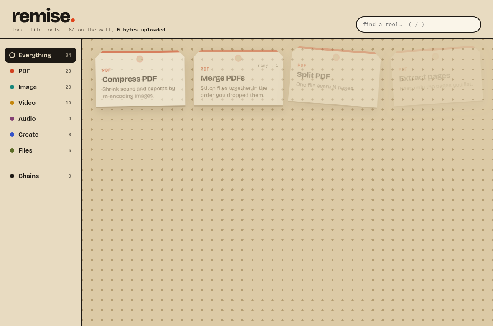
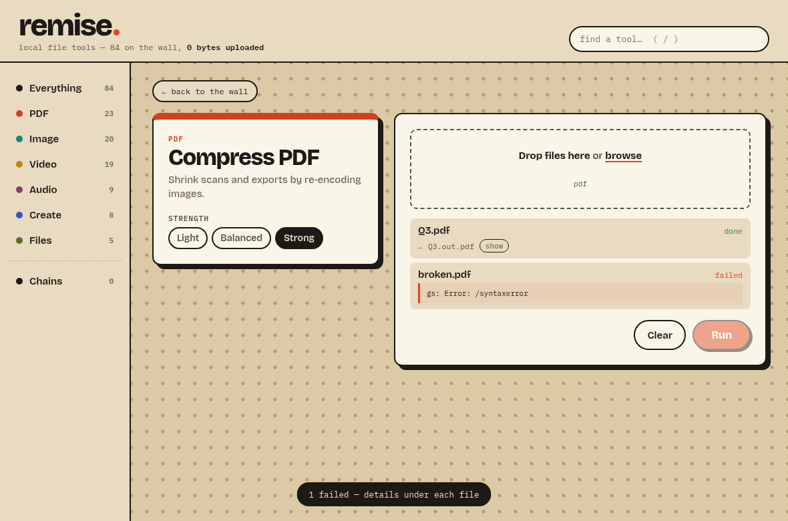
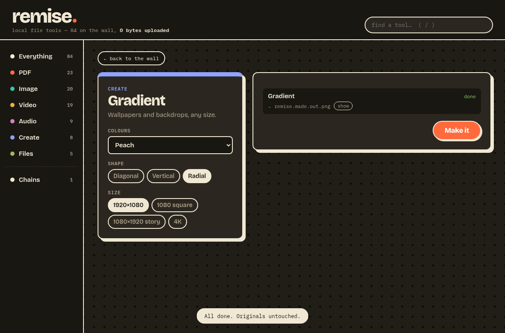

# remise.

Local file tools for PDF, image, video, audio and archives, in one desktop app. Drop files and pick a tool, or line tools up into a chain. Nothing is uploaded, and your originals are never overwritten.



Remise is a thin, honest wrapper around the classics: Ghostscript, qpdf, Tesseract, FFmpeg, ImageMagick, 7-Zip and Potrace. Each tool is a few lines of data describing which binary to call with which arguments. The work is done by programs that have been doing it well for decades.

## What's on the wall

There are 89 tools.

| Family | Tools |
|---|---|
| **PDF** (27) | Compress, Merge, Split, Extract pages, Organize pages (reorder/drop), Attach to each (a cover or terms page added to every PDF), Flatten, Repair, Office to PDF (LibreOffice), Rotate pages, OCR (PDFs and photos → searchable PDF), PDF to images, Images to PDF, Extract text, PDF to Markdown, Grayscale, Encrypt (AES-256), Unlock, Optimize for web, Redact (flattened, so nothing stays under the black boxes), Sign (stamps a signature image), Crop margins, Page numbers, Stamp (DRAFT, PAID…), Ebook (EPUB) to PDF, HTML to PDF, **PDF Studio** (opens the file in [PdfCraft](https://github.com/storytold/pdfcraft) to annotate, sign, redact and reorder) |
| **Image** (21) | Convert (WebP/AVIF/PNG/JPG/TIFF/GIF), Compress, Resize, Crop to ratio, Rotate & flip, Auto-crop borders, Strip metadata, Extract text (OCR), Redact (black box or pixelate), SEO image (WebP, ≤1600 px, slug name), Compare (side by side or differences), Logo on each, Remove background (rembg), Vectorize to SVG, Stylize, Watermark, Upscale, AI Upscale (Real-ESRGAN), Icon pack (.ico), Color palette, Contact sheet |
| **Video** (19) | Compress (H.264), Convert, Video to GIF, Trim, Split, Crop to ratio, Resize, Rotate, Change speed, Mute, Extract audio, Add audio (replace or mix), Join, Insert clip, Watermark (logo), Caption (burn in an .srt), Transcribe (Whisper → SRT/VTT/text), Extract frames, Video downloader (yt-dlp) |
| **Audio** (9) | Convert, Compress, Trim, Split, Merge, Volume & normalize (−16 LUFS), Speed, Waveform image, Audiogram (audio → video with a live waveform) |
| **Create** (8) | Device mockup (browser or phone), Beautify shot (rounded corners, shadow, gradient), HTML to image, Gradient, Shader backdrop (animated procedural backgrounds), Font specimen, Carousel (slice a wide image into posts), QR code |
| **Files** (5) | Create archive (zip/7z), Extract archive (zip, 7z, rar, tar, iso…), Batch rename, Change file dates, Sort & route (into folders by kind, extension or month) |

Some tools need an optional install. They show up hatched on the wall until it's there, with the install command in the tooltip:
- **rembg** for background removal.
- **Real-ESRGAN** for AI upscale.
- **Whisper** for transcription.
- **yt-dlp** for the video downloader.
- **PdfCraft** for PDF Studio.
- **LibreOffice** for Office to PDF.
- **Chrome, Edge or Chromium** for HTML/EPUB rendering. Edge ships with every Windows.

**Create** tools that start from nothing (Gradient, Shader backdrop, QR code, Video downloader) save their result to Downloads.

**Chains** run several tools one after another, for example *Compress PDF → Grayscale → Optimize for web*. Each step's output becomes the next step's input. Intermediate files stay in a temp folder, and only the final result appears next to your file, as `contract.compressed.gray.web.pdf`.

**Batch** works with any tool: drop a folder's worth of files and each one is processed. Tools such as Merge, Join or Contact sheet instead combine everything you dropped into a single output.

**Dropping files on the wall** filters it down to the tools that can take them. If exactly one tool fits, it opens straight away.





## Download

Releases come in four builds: Windows x64 (NSIS installer), macOS Apple Silicon and Intel (.dmg), and Linux x64 (AppImage). Here is what each build bundles:

| | Windows | macOS | Linux AppImage |
|---|---|---|---|
| FFmpeg, qpdf, 7-Zip | bundled | bundled | bundled |
| Potrace | bundled | bundled (Intel), install on Apple Silicon | bundled |
| Ghostscript, Tesseract, ImageMagick | bundled | `brew install ghostscript tesseract imagemagick` | from your distro |
| rembg, PdfCraft (optional) | install separately | install separately | install separately |

The app looks for bundled binaries first, then for ones you have installed. A tool whose binary is missing shows up hatched on the wall, with the install command in its tooltip.

The builds are not code-signed yet. On macOS, right-click the app and choose **Open** the first time. If a bundled tool is still blocked, run `xattr -dr com.apple.quarantine /Applications/Remise.app`. On Windows, choose **More info → Run anyway** in SmartScreen.

## How it works

```
src/                    the UI: plain HTML/CSS/JS, no framework, no bundler
src-tauri/src/
  tools.rs              the registry: one entry per tool (data + a pure argv builder)
  runner.rs             runs a chain of tools; scratch dir, progress, never overwrites
  bins.rs               finds binaries: vendor/ first, then PATH and the usual places
  tests/                unit tests, the real-binary smoke test, and the manifest dump
scripts/vendor.py       fetches the bundled binaries, pinned by URL + SHA-256
```

Adding a tool means adding one `Tool { … }` entry to `tools.rs`. The UI renders its parameters on its own, and the chain builder picks it up automatically.

Commands are always spawned with an argument vector and never through a shell, because file names are user input. For the same reason, the UI builds every node with `textContent` and never uses `innerHTML`.

## Development

```sh
pnpm install
pnpm tauri dev          # run the app
pnpm lint               # eslint (complexity ≤ 10) + clippy -D warnings (cognitive complexity ≤ 15)
pnpm test               # unit tests
pnpm smoke              # every tool against the real binaries on generated fixtures
pnpm test:ui            # headless walk-through of the UI (needs a Chromium)
python3 scripts/vendor.py linux-x64   # fetch bundled binaries into vendor/ (windows-x64, macos-arm64, macos-x64)
python3 scripts/coverage.py src-tauri/target/manifest.json   # replay the 77/77 check against hangar.tools
```

CI runs lint and unit tests on all three OSes, then the smoke test on each one against the bundled binaries. Pushing a `v*` tag builds all four installers into a draft release.

## Coverage of Hangar's tool list

Remise was built clean-room, using only Hangar's public website as a guide. Their tools page (`hangar.tools/tools/`) shows 89 cards: 77 shipped and 12 marked *soon*. **Every one of the 77 shipped tools has a counterpart here.** Three of the *soon* ones (Flatten, Repair, Office to PDF) are already in Remise.

To replay the check against their live page:

```sh
REMISE_MANIFEST=$PWD/src-tauri/target/manifest.json cargo test --manifest-path src-tauri/Cargo.toml -- --ignored manifest
python3 scripts/coverage.py src-tauri/target/manifest.json
# hangar.tools: 77 shipped, 12 marked soon
# remise: 89 tools, covers 77/77 shipped
```

The mapping from their tool ids to ours lives in `scripts/coverage.py`. Where the two differ in depth:
- **Redact** works on areas given in %, with no text search.
- **Sign** places a signature image; it is not a cryptographic signature.
- **Ebook to PDF** reads EPUB only.
- **Fonts** produces a specimen sheet.
- **Remove background, AI Upscale, Transcribe and Video downloader** need an optional install (rembg, Real-ESRGAN, Whisper, yt-dlp).
- **HTML and EPUB rendering** uses the Chrome, Edge or Chromium already on the machine.

Remise also has tools that their list doesn't: Grayscale PDF, Optimize for web, PDF Studio (via PdfCraft), Auto-crop borders, non-AI Upscale, Extract frames, Waveform image, and Chains.

## Licences

Remise is MIT-licensed. The bundled programs keep their own licences: Ghostscript is AGPL-3.0, FFmpeg (in these builds) and Potrace are GPL, 7-Zip is LGPL, and the rest are Apache-style. Remise only runs them as separate processes and never links them. Every build includes `vendor/THIRD_PARTY.md`, which lists each program's version, licence, binary URL and corresponding source, along with the licence texts. The bundled fonts, Bricolage Grotesque and IBM Plex Mono, are under the SIL OFL 1.1.

## Known limits

These are deliberate shortcuts, marked `CBA:` in the code (`grep -rn CBA:`):

- Builds are unsigned (see above).
- macOS does not bundle Ghostscript, Tesseract or ImageMagick, because upstream ships no relocatable macOS build.
- On Ubuntu 22.04/24.04 and Debian 12, the distro's ImageMagick 6 refuses to write PDF by default (`policy.xml`), which breaks *Images to PDF* there.
- *Join videos* copies streams without re-encoding, so the clips need matching codecs (same camera or same export settings).
- *Batch rename* has no live preview and no undo, and a running job can't be cancelled yet.
- *Change file dates* reads the date as UTC.
- *Stamp* uses light tints, because Ghostscript 10 dropped the constant-alpha operator.
- *Sign* expects A4 pages, and the signature drifts a little on other page sizes.
- *Insert clip* needs both videos to have an audio track.

Remise is an independent clean-room project. It is not affiliated with any commercial product.
