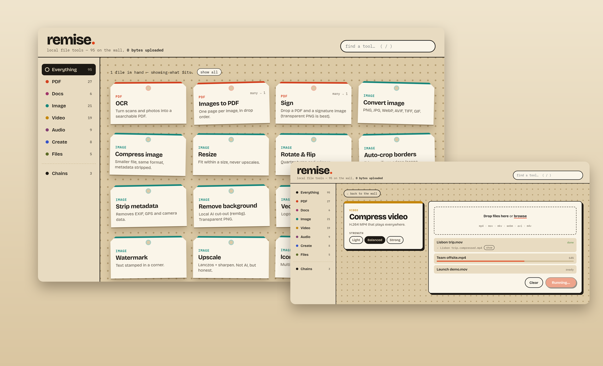
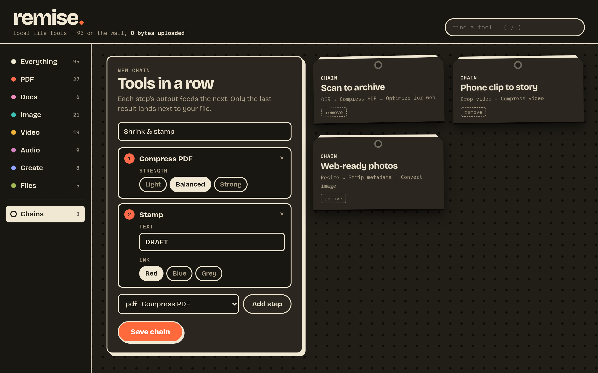
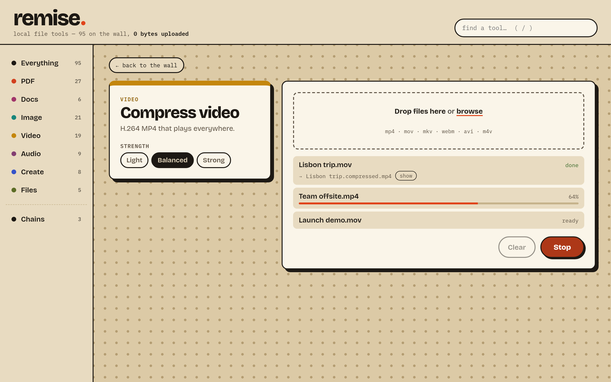

# remise.

**Remise is a free toolbox for your files.** Compress a PDF, turn a video into a GIF, convert a Word document, remove a photo's location data, make a QR code — 95 small tools in one desktop app.

Everything happens **on your computer**. Nothing is uploaded, there's no account, and it works offline. Your original files are never changed: every result is saved as a new file next to the original.



## Download

Get the latest version from the **[Releases page](https://github.com/baptisterajaut/remise/releases/latest)**, then pick the file for your computer:

| Your computer | File to download |
|---|---|
| Windows 10 or 11 | the one ending in `x64-setup.exe` |
| Mac with Apple chip (M1, M2, M3, M4…) | the one ending in `aarch64.dmg` |
| Mac with Intel chip | the one ending in `x64.dmg` |
| Linux | the one ending in `.AppImage` |

Not sure which Mac you have? Open  menu → **About This Mac**. "Chip: Apple M…" means Apple chip; "Processor: Intel…" means Intel.

## Install

**Everything Remise needs comes with it**, on every system: Ghostscript, ImageMagick, FFmpeg, Pandoc, Tesseract's OCR and the rest are inside the app. Nothing else to install: the few tools that need something bigger (an AI model, LibreOffice…) offer to download it the first time you open them.

### Windows

1. Double-click the `…setup.exe` you downloaded.
2. Windows may show a blue box saying *"Windows protected your PC"*. The app isn't code-signed yet (signing costs money every year), and that is why the box appears. Click **More info**, then **Run anyway**.
3. Follow the installer. Remise is then in your Start menu.

### Mac

1. Open the `.dmg` and drag **Remise** into **Applications**.
2. Open Remise. The first time, macOS refuses because the app isn't signed with an Apple certificate yet, and that's expected. Click **Done** (or **OK**), then:
   - open **System Settings → Privacy & Security**;
   - scroll down to the message about Remise and click **Open Anyway**;
   - confirm with your password.

   You only do this once. On macOS 14 or older, you can instead right-click Remise → **Open** → **Open**.

If macOS says Remise "is damaged and can't be opened", or that a tool "can't be opened", run this once in the Terminal. Nothing is damaged; this removes the "downloaded from the internet" flag that blocks unsigned apps:

```
xattr -dr com.apple.quarantine /Applications/Remise.app
```

### Linux

1. Make the file executable: right-click it → *Properties* → *Allow executing as program*. Or, in a terminal: `chmod +x Remise_*.AppImage`.
2. Double-click it to run it.

It runs on Ubuntu 22.04 or newer, Debian 12, Fedora 36 and other distributions of that age or newer.

## How to use it

1. **Drop files on the window**, or pick a tool first. When you drop files on the main screen, Remise shows only the tools that can use them.
2. **Pick a tool** and adjust its settings if you like. The defaults are sensible.
3. **Press Run.** Each result appears next to the original, with a name that says what was done to it. For example, `contract.pdf` gives `contract.compressed.pdf`. Click **show** to open the folder.

A few more things to know:

- **Many files at once.** Drop as many as you want; each one is processed in turn. Some tools (Merge PDFs, Join videos, Contact sheet…) combine everything you dropped into one result instead.
- **Chains.** Under *Chains* you can line tools up, for example *Compress PDF → Grayscale → Optimize for web*, and run the whole thing in one go. Only the final file is kept.

  

- **Making something from scratch.** Tools such as *Gradient*, *QR code* or *Video downloader* don't need a file. Their results go to your **Downloads** folder.
- **Search.** Press `/` to search for a tool by name.



## What's inside

<details>
<summary><b>All 95 tools</b> (click to open)</summary>

| Family | Tools |
|---|---|
| **PDF** (27) | Compress, Merge, Split, Extract pages, Organize pages, Rotate pages, OCR (scans → searchable PDF), PDF to images, Images to PDF, Extract text, PDF to Markdown, Grayscale, Encrypt, Unlock, Optimize for web, Redact, Sign, Crop margins, Page numbers, Stamp, Attach to each (a cover or terms page on every PDF), Flatten, Repair, Office to PDF, Ebook (EPUB) to PDF, HTML to PDF, PDF Studio |
| **Docs** (6) | Convert document (Word, OpenDocument, PDF, web page, EPUB, RTF, text), To Markdown, Markdown to PDF, Markdown to Word, Markdown to slides, PDF to Ebook |
| **Image** (21) | Convert, Compress, Resize, Crop, Rotate & flip, Auto-crop borders, Strip metadata, Extract text, Redact (black box or pixelate), SEO image, Compare, Logo on each, Remove background, Vectorize, Stylize, Watermark, Upscale, AI Upscale, Icon pack, Color palette, Contact sheet |
| **Video** (19) | Compress, Convert, Video to GIF, Trim, Split, Crop, Resize, Rotate, Change speed, Mute, Extract audio, Add audio, Join, Insert clip, Watermark, Caption (burn in subtitles), Transcribe, Extract frames, Video downloader |
| **Audio** (9) | Convert, Compress, Trim, Split, Merge, Volume & normalize, Speed, Waveform image, Audiogram |
| **Create** (8) | Device mockup, Beautify shot, HTML to image, Gradient, Shader backdrop, Font specimen, Carousel, QR code |
| **Files** (5) | Create archive, Extract archive, Batch rename, Change file dates, Sort & route |

</details>

A few tools need something too big to put in every download. The first time you open one, its button says **Download** and how big it is. Press it once, and from then on that tool works offline like the others.

| Tool | Downloads, once |
|---|---|
| Remove background | an AI model, 224 MB |
| Transcribe | a speech model, 190 MB |
| Office to PDF | LibreOffice, 300 to 376 MB |
| PDF Studio (annotate, sign, fill forms) | [PdfCraft](https://github.com/storytold/pdfcraft), 115 to 129 MB |
| HTML to PDF, HTML to image | Chromium, 105 to 128 MB, only on a Mac or Linux PC with no Chrome, Edge or Chromium |

## Questions

**Is it really free?** Yes. Remise is open source under the MIT licence. The heavy lifting is done by long-standing free programs: Ghostscript, FFmpeg, ImageMagick, Pandoc, Tesseract, qpdf, 7-Zip and others.

**Does anything get uploaded?** No. Files are read and written on your disk only. Remise goes online in two cases only: the *Video downloader* fetches the video you asked for (and updates itself first, because video sites change often), and a **Download** button fetches what its tool needs, once.

**Will it overwrite my files?** No. Results always get a new name. If that name is already taken, Remise adds `-2`, `-3` and so on.

**A tool failed. What now?** The reason is shown under the file, in red. Most of the time the file isn't the kind the tool expects, or a setting has a typo (a page range, a time). If it looks like a bug, please [open an issue](https://github.com/baptisterajaut/remise/issues) and paste that message.

**AI Upscale says "vkCreateInstance failed".** It needs an up-to-date graphics driver (any GPU from the last ten years has one). On Linux without a GPU, install your distribution's `mesa-vulkan-drivers` (or `vulkan-swrast`). Macs need nothing.

**Why is a tool striped?** It needs something that isn't on this computer yet. Open it: most of the time its button offers to download it. Otherwise, hover over it to see what to install.

## For developers

See [docs/DEVELOPMENT.md](docs/DEVELOPMENT.md) for how it's built, tested and released, the bundled programs and their licences, and the known limits. [docs/COVERAGE.md](docs/COVERAGE.md) explains how Remise compares with Hangar, the commercial app that inspired it. Remise is an independent, clean-room project and is not affiliated with it.
